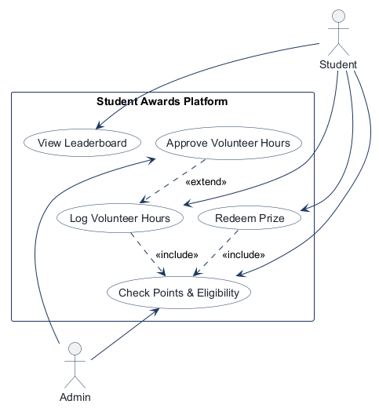
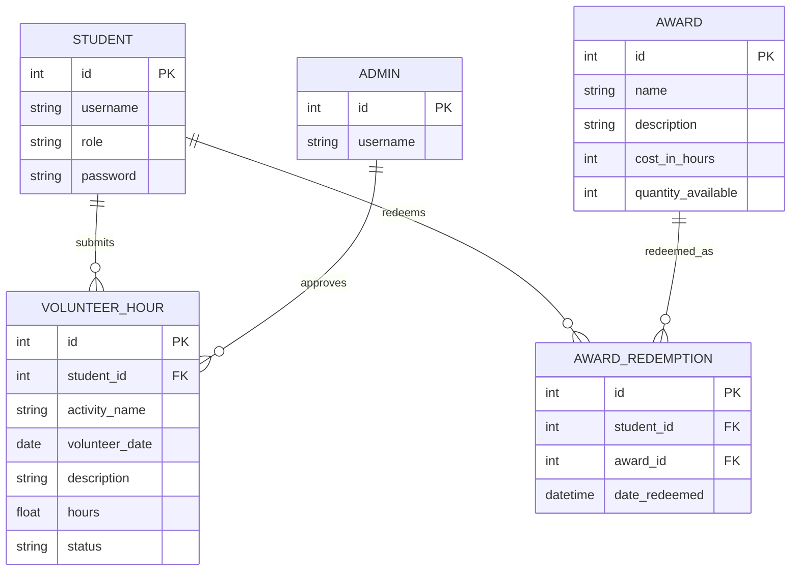
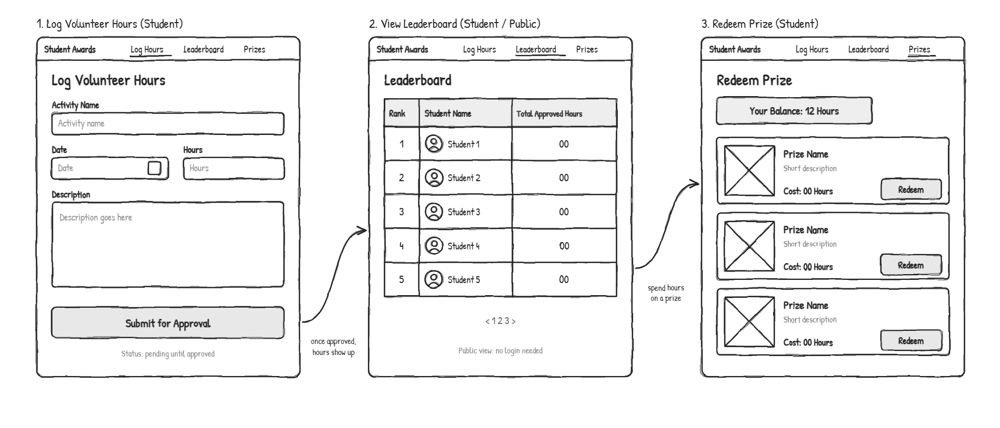

# COMP 3613 Assignment 1

Draft this file with the Guide. **Update it after every phase milestone** before you pause. The use-case diagram is a UML PNG at `docs/diagrams/use-case.png`, linked from this file as `diagrams/use-case.png` (path relative to `docs/report.md`). The model diagram is Mermaid. **Embed wireframe images** as `wireframes/<file>` (files live in `docs/wireframes/`).

Do not put your student ID in this file if you will commit it. The PDF cover adds your name and ID at export time.

## Assigned project
Student Awards

## Three workflows

### 1. Log Volunteer Hours (Student)
Student records volunteer time and submits it for validation.

### 2. View Leaderboard (Student)
Student checks current points and rank relative to peers.

### 3. Redeem Prize (Student)
Student reviews available rewards, confirms eligibility, and redeems an award using earned points.

## Use case diagram

Phase 2 decision: a shared "Check Points & Eligibility" use case is used by both "Log Volunteer Hours" and "Redeem Prize"; "Approve Volunteer Hours" extends the submission flow and points are only added after admin approval.

## Model diagram

Phase 3 draft. This version follows the student-supplied entity list and keeps the approval flow explicit: a student submits hours, an admin reviews those submissions, and the student later redeems a prize using earned hours/points. `Admin` is treated as a separate approval role for now. The key business rules are: 1) volunteer hours start as `Pending`, then become `Approved` or `Rejected`; 2) only approved hours count toward the student's balance; 3) each redemption decreases the available quantity of the selected award; 4) redemption uses the student's current earned hours/points balance. If you later prefer a single `Student` table with a `role` column, the admin record can be collapsed without changing the workflow.

## Wireframes

Phase 4 wireframe review: the student-crafted image covers all three named workflows. The hours form's activity name and date are now represented in `VOLUNTEER_HOUR` as `activity_name` and `volunteer_date`. The leaderboard displays total approved hours, consistent with the model's approval rule. Redemption requires a confirmation popup; if the student has insufficient hours, show an "Insufficient hours" error and do not deduct anything. Disable the Redeem button when an award is out of stock.

## Theming

The existing Student Awards palette is retained: navy and dark blue with teal and amber accents on light neutral backgrounds. The student confirmed that the finished UI matches the supplied wireframes.

## Implementation notes

### Phase 5 complete

The student verified the finished UI against the wireframes and confirmed that the app logic works.

- **Log Volunteer Hours:** Students submit an activity, date, notes, and hours. New submissions remain `Pending` until an admin reviews them.
- **View Leaderboard:** A separate full-width leaderboard page shows students' approved volunteer hours. The page remains publicly viewable.
- **Redeem Prize:** A separate prizes page shows the student's available balance and prize cards. The student tested redemption and confirmed that the balance is deducted correctly. Redeemed stock is reduced.
- **Admin approval:** The admin approval page was tested and the student confirmed that approving pending hours works.
- **Navigation and layout:** The left sidebar was replaced with top navigation between Log Hours, Leaderboard, and Prizes. The student confirmed the resulting UI matches the wireframes.
- **Demo seed data:** Each of the three seeded prizes is configured with an initial quantity of 10.

Local verification used the seeded accounts listed below. Phase 6 deployment has not yet been completed.

## Deployed app

Phase 6. Public Render URL (not localhost). Markers open this to mark the three workflows.

https://

## Logins

Every account a marker needs, including extra users you added. Starter accounts:

- bob / bobpass — regular user
- admin / adminpass — admin

## YouTube URL

## Session transcripts

Filled when the Guide builds the report: the agent writes each Guide chat to `docs/transcripts/<slug>.md` (Copilot Agent, Cursor, or OpenCode). `python manage.py report` packages them. Do not paste chats here during the build.

## Competency (student-judge)

Filled when the report is built. Guide runs student-judge, writes `docs/judge.md`, and export appends the scorecard here.

## Skill integrity

Filled by `python manage.py report`. Do not edit the course skills.
