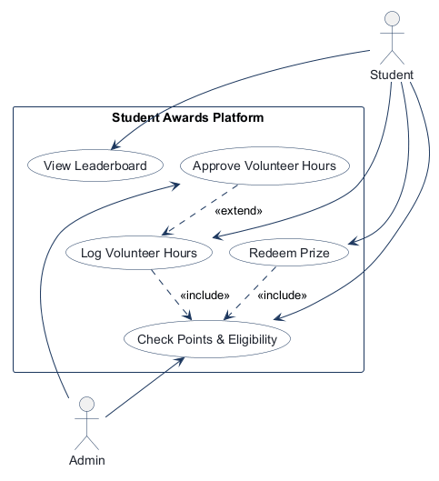
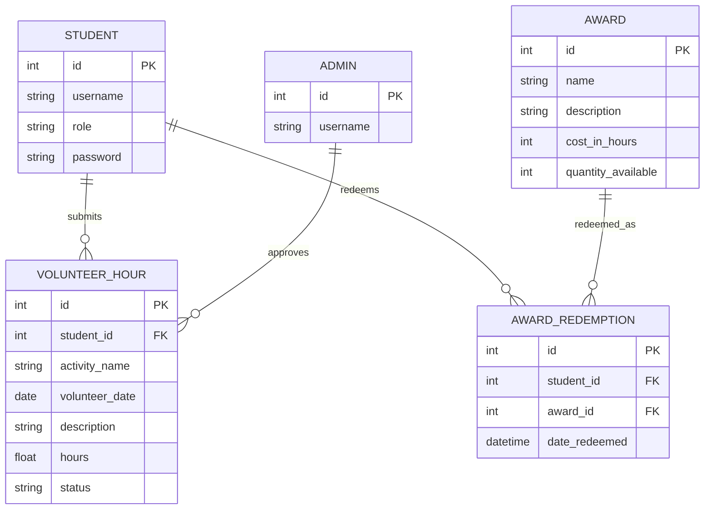
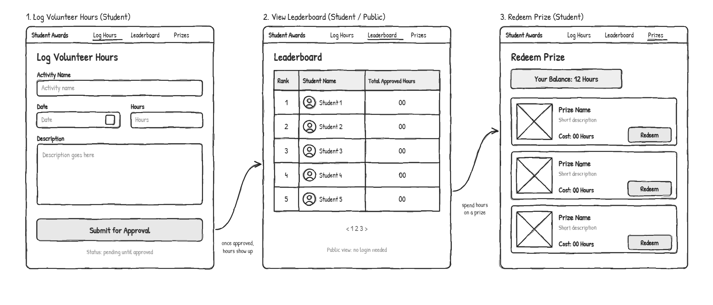

<!-- student-build:skill-integrity
status: pass
root: e84cd692d0b85eefe546385661958c27d07e8be6c5176a82012f68ccff5c8beb
expected_root: e84cd692d0b85eefe546385661958c27d07e8be6c5176a82012f68ccff5c8beb
mismatches: none
-->

# COMP 3613 Assignment 1

Draft this file with the Guide. **Update it after every phase milestone** before you pause. The use-case diagram is a UML PNG at `docs/diagrams/use-case.png`, linked from this file as `diagrams/use-case.png` (path relative to `docs/report.md`). The model diagram is Mermaid. **Embed wireframe images** as `wireframes/<file>` (files live in `docs/wireframes/`).

Do not put your student ID in this file if you will commit it. The PDF cover adds your name and ID at export time.

## Assigned project
Student Awards

## Three workflows

### 1. Log Volunteer Hours (Student)
Student records volunteer time and submits it for validation.

### 2. View Leaderboard (Student)
Student checks current points and rank relative to peers.

### 3. Redeem Prize (Student)
Student reviews available rewards, confirms eligibility, and redeems an award using earned points.

## Use case diagram

Phase 2 decision: a shared "Check Points & Eligibility" use case is used by both "Log Volunteer Hours" and "Redeem Prize"; "Approve Volunteer Hours" extends the submission flow and points are only added after admin approval.

## Model diagram

Phase 3 draft. This version follows the student-supplied entity list and keeps the approval flow explicit: a student submits hours, an admin reviews those submissions, and the student later redeems a prize using earned hours/points. `Admin` is treated as a separate approval role for now. The key business rules are: 1) volunteer hours start as `Pending`, then become `Approved` or `Rejected`; 2) only approved hours count toward the student's balance; 3) each redemption decreases the available quantity of the selected award; 4) redemption uses the student's current earned hours/points balance. If you later prefer a single `Student` table with a `role` column, the admin record can be collapsed without changing the workflow.

## Wireframes

Phase 4 wireframe review: the student-crafted image covers all three named workflows. The hours form's activity name and date are now represented in `VOLUNTEER_HOUR` as `activity_name` and `volunteer_date`. The leaderboard displays total approved hours, consistent with the model's approval rule. Redemption requires a confirmation popup; if the student has insufficient hours, show an "Insufficient hours" error and do not deduct anything. Disable the Redeem button when an award is out of stock.

## Theming

The existing Student Awards palette is retained: navy and dark blue with teal and amber accents on light neutral backgrounds. The student confirmed that the finished UI matches the supplied wireframes.

## Implementation notes

### Phase 5 complete

The student verified the finished UI against the wireframes and confirmed that the app logic works.

- **Log Volunteer Hours:** Students submit an activity, date, notes, and hours. New submissions remain `Pending` until an admin reviews them.
- **View Leaderboard:** A separate full-width leaderboard page shows students' approved volunteer hours. The page remains publicly viewable.
- **Redeem Prize:** A separate prizes page shows the student's available balance and prize cards. The student tested redemption and confirmed that the balance is deducted correctly. Redeemed stock is reduced.
- **Admin approval:** The admin approval page was tested and the student confirmed that approving pending hours works.
- **Navigation and layout:** The left sidebar was replaced with top navigation between Log Hours, Leaderboard, and Prizes. The student confirmed the resulting UI matches the wireframes.
- **Demo seed data:** Each of the three seeded prizes is configured with an initial quantity of 10.

The student confirmed that all three workflows were tested successfully on the live deployment.

## Deployed app

Phase 6 deployment is live on Render. The student tested all three workflows on the live app. `GET /health` was verified and returned `{"ok":true}`.

Public URL: https://faststarter-n80u.onrender.com

## Logins

Marker login credentials:

- Username: `bob` — Password: `bobpass` — Role: regular user
- Username: `admin` — Password: `adminpass` — Role: admin

## YouTube URL
https://youtu.be/QkKt_E0Fi7E

## Session transcripts

Filled when the Guide builds the report: the agent writes chat markdown into `docs/transcripts/`; `python manage.py report` packages them.

Guide packaged **7** chat(s) in `docs/transcripts/` (and `docs/transcripts.zip`).

Index: [docs/transcripts/INDEX.md](transcripts/INDEX.md)

- [`phase-1-project-and-workflows`](transcripts/phase-1-project-and-workflows.md)
- [`phase-2-use-cases`](transcripts/phase-2-use-cases.md)
- [`phase-3-model`](transcripts/phase-3-model.md)
- [`phase-4-wireframes`](transcripts/phase-4-wireframes.md)
- [`phase-5-implementation-and-polish`](transcripts/phase-5-implementation-and-polish.md)
- [`phase-6-deployment`](transcripts/phase-6-deployment.md)
- [`report-build`](transcripts/report-build.md)

## Competency (student-judge)

Filled by Guide from the student-judge run when this report was built.

**Judged at:** 2026-10-12T08:31:08-04:00
**Evidence pass:** re-read all 7 user-supplied Copilot JSON exports as user-visible markdown transcripts, current docs/report.md, diagrams/wireframe, and implementation; prior judge.md ignored.

# student-judge competency report

**Student / session:** Student Awards
**Artifact:** Copilot Agent chat exports supplied from the Assignments and comp3613a1 workspaces, current report, diagrams, wireframe, and implementation
**Phases in evidence:** 1-6 (COMP 3613; Phase 5 polish, Phase 6 deploy; never generic 0-5)

### Totals
| | Count / value |
|--|--|
| Metrics on rubric | 12 (M1-M12) |
| N/A (excluded) | 0 |
| Metrics scored | 12 |
| Scoreable max | 48 |
| Awarded total | 42 / 48 |
| **Overall (avg of scored)** | **3.5 / 4** |
| Impression mark | 18 / 20 |

## Scorecard

| ID | Metric | Score / 4 | In avg | Evidence |
|----|--------|----------:|:------:|----------|
| M1 | Phase discipline | 3 | yes | The student explicitly corrected the initial all-at-once build: “you built everything at once, slow down,” then required one workflow and verification before moving on. The student later proceeded through UI polish and deployment. |
| M2 | Problem framing | 3 | yes | The report identifies three concrete workflows and the Phase 3 transcript contains a student-authored entity/property list. Phase 2's transcript records only “start phase 2,” so the report's include/shared-use-case decisions are not strongly evidenced as student answers in the chat. |
| M3 | Decision ownership | 3 | yes | The student steered the layout and workflow polish, including “Remove the left sidebar entirely” and the precise Log Hours, Leaderboard, and Prizes page requirements. Entity details were also supplied directly in the Phase 3 chat. |
| M4 | Artefact-before-code | 3 | yes | The use-case/model artefacts and student wireframe appear before Phase 5 implementation. The student later required the implementation to “match the wireframe I created.” |
| M5 | Verification habit | 4 | yes | The student reported “its worked” after the Log Volunteer Hours test, later confirmed “the admin approval works properly and the app logic is functional,” and reported testing all three workflows on the live app. |
| M6 | Assignment fit | 4 | yes | The implementation follows the intended assignment and layered design: routes call service/repository helpers rather than embedding SQL; the Phase 5 student requirement was to “implement one workflow at a time”; theme, build, and polish preceded the documented Render deployment. |
| M7 | Slice explanation | 2 | yes | The Guide assigned SQLModel and route edits for the first workflow. The student responded “its worked” but the supplied chat does not show the completed snippets or a layer explanation. Repo architecture is layered; this score is for the limited demonstrated code-check response, not a fat-route violation. |
| M8 | Prompt quality | 4 | yes | The student gave specific, actionable constraints: “Do not change the backend logic, just fix the styling,” and described the CSS defects and desired centered white container. |
| M9 | Response to pushback | 4 | yes | The student caught the all-at-once build, insisted on local verification of one workflow, then reported and refined UI defects, navbar state, admin approval, and prize reset/seed behavior. |
| M10 | Integrity | 4 | yes | Protected skills passed `python manage.py skills-verify`; no actual suspicion spiral, laundering signal, or skill-edit evidence appears in the student-visible conversations. |
| M11 | Provenance continuity | 4 | yes | The Phase 5 prompts explicitly tie the new layout to `docs/wireframes/image.png`, and the resulting pages preserve the named volunteer-hours, leaderboard, and prize workflows. |
| M12 | Sincerity trajectory | 4 | yes | No actual `student-judge:sincerity` log blocks were present in the supplied chats; marker text appeared only in Guide/tool context. No suspicion was raised, and the student continued with concrete testing and corrections. |

## Strengths
- The student actively interrupted a bulk implementation and reset the work to one workflow at a time, then reported a local result.
- Strong, specific UI polish steering: separate pages, top navigation, layout and styling corrections, and logged-in navbar behavior.
- Verification evidence spans volunteer-hour submission, admin approval, redemption/balance behavior, and the deployed app.
- The final implementation uses the assignment's layered route/service/repository approach and stays aligned with the ERD and wireframe.
- Phase 6 deployment and live health-check evidence are recorded in the report and deployment chat.

## Gaps (priority order)
1. The assigned Phase 5 code-check is not fully evidenced: after being given SQLModel/route edits, the student reported success but did not include the resulting snippets or explain the layer choices in the supplied chat. The implementation itself uses layered persistence and no route-level SQL was found.
2. The Phase 2 conversation does not show the student's include/extend or shared-use-case answers; the use-case diagram and report record those decisions, but their ownership is less visible than the Phase 3 entity list and Phase 5 steering.

## Phase gate status
| Phase | Status | Note |
|-------|--------|------|
| 1 | met | The report records Student Awards and three named workflows; the short native chat itself does not preserve the workflow-list turn. |
| 2 | partial | Use-case diagram and shared/extend notes exist, but the available chat has no student decision turn beyond “start phase 2.” |
| 3 | partial | The student supplied the entities and properties and confirmed the business-rule summary; relationship choice was not explicitly discussed in the supplied conversation. |
| 4 | met | Student wireframe is present and covers the three workflows; the report and implementation record the additional redemption states. |
| 5 | met | Theme/build were followed by verification and substantial UI/workflow polish; this was not accepted as a first-build-only result. |
| 6 | met | Render deployment, public URL, marker logins, and successful `/health` result are documented. |

## Recommended next practice
- In a future workflow slice, write and explain the assigned model and thin-route snippets explicitly (including which service/repository call handles persistence), then verify the result as you did for Log Volunteer Hours.

## Integrity note
- Clean
## Provenance flags
- None
## Sincerity log summary
- Blocks found: 0 actual sincerity blocks; the marker string appeared only in Guide/tool context | max round: 0 | min/mean/final confidence: n/a | trend: n/a | cleared: n/a
## Skips
- Skips: 0/3 used (no skip turn found in the supplied chats)

## Skill integrity

Course skills are hashed at export and compared to `.agents/skills.lock.json`. Do not edit `.agents/skills/`, `.cursor/skills/`, or `AGENTS.md`.

- Status: **pass**
- Root: `e84cd692d0b85eefe546385661958c27d07e8be6c5176a82012f68ccff5c8beb`
- none
